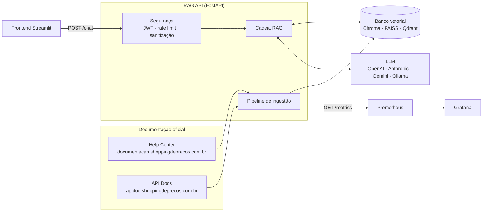
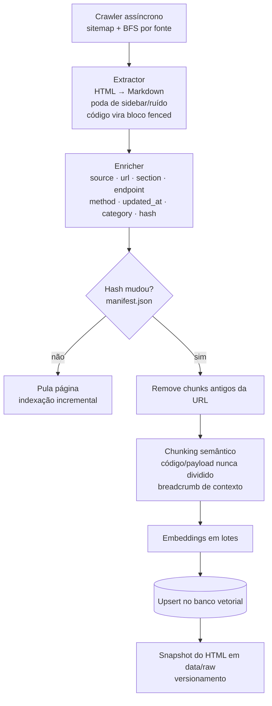
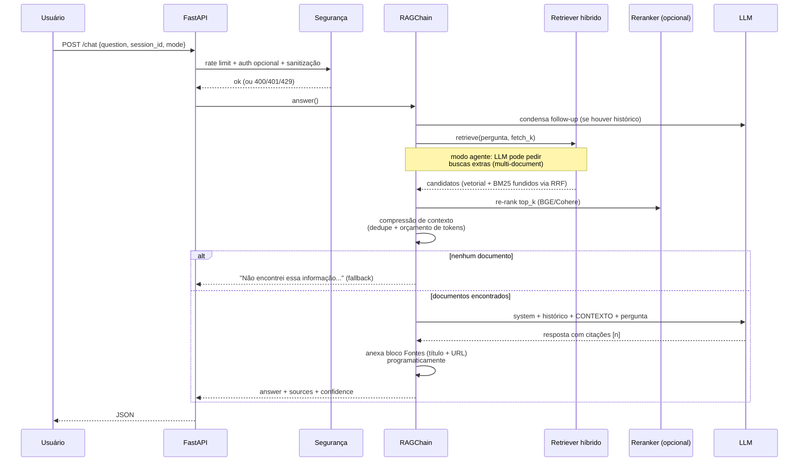
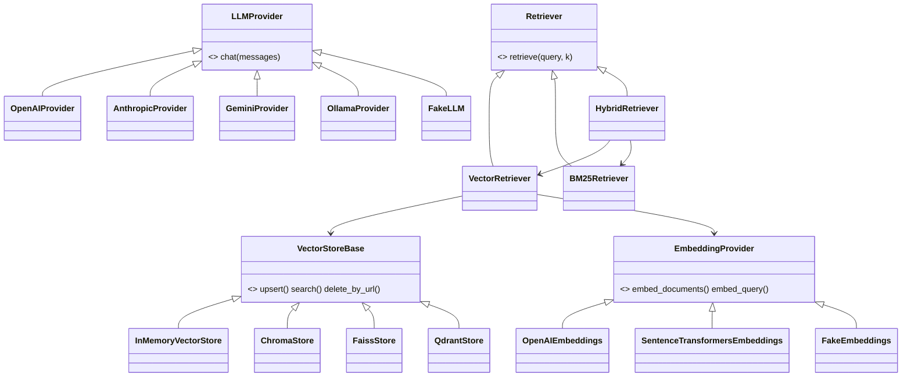

# Arquitetura

## Visão geral (containers)

## Pipeline ETL (RF01–RF03)

## Fluxo de uma pergunta (POST /chat)

## Portas e adapters (Clean Architecture)

O `app/container.py` (composition root) é o único módulo que instancia adapters
concretos. Rotas e cadeia conhecem apenas as portas — por isso trocar Chroma por
Qdrant, ou GPT por Claude, é alterar **uma linha do `.env`**.

## Anti-alucinação (defesa em profundidade)

1. **Prompt**: o system prompt proíbe conhecimento externo e exige a frase de
   fallback exata quando o contexto não cobre a pergunta.
2. **Código**: se o retrieval volta vazio, a cadeia devolve o fallback **sem
   chamar o LLM**; se o LLM emitir o fallback, as fontes são zeradas.
3. **Fontes**: o bloco `Fontes:` (título + URL) é montado pelo código a partir
   dos chunks realmente usados — o LLM não tem como inventar URLs.
4. **Injection**: documentos são declarados "dados, não comandos" no prompt, e
   a entrada do usuário passa por sanitização + heurística opcional de bloqueio.
